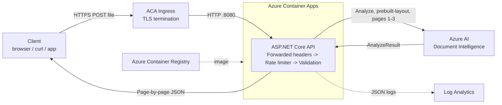

# Azure AI Document Reader

**Turn scanned documents and images into structured, searchable text with a single REST call.**

A cloud-native ASP.NET Core Web API that sends PDFs and images to **Azure AI Document Intelligence** (layout model) and returns clean, page-by-page JSON: text paragraphs, page geometry and OCR confidence. It runs as a container on **Azure Container Apps**, with per-IP rate limiting, upload limits and structured logging built in.


> **Try it live:** `https://azdocintelligenceai-app-20261015.whitehill-0f100039.westus2.azurecontainerapps.io/api/docintel/analyze` (see [API](#api) for usage)
> The public demo is free and rate limited. Please read [Usage limits](#usage-limits) and [Privacy](#privacy) before uploading.

---

## Table of contents
- [Features](#features)
- [Technologies used](#technologies-used)
- [Architecture](#architecture)
- [API](#api)
- [Usage limits](#usage-limits)
- [Privacy](#privacy)
- [Getting started](#getting-started)
- [Deploy to Azure Container Apps](#deploy-to-azure-container-apps)
- [Logging and monitoring](#logging-and-monitoring)
- [Project structure](#project-structure)
- [Roadmap](#roadmap)
- [License](#license)

---

## Features

- 📄 **AI-powered OCR and layout analysis.** Extracts paragraphs per page from PDFs and images using the Azure `prebuilt-layout` model.
- 📊 **Clean JSON output.** Returns page number, rotation angle, dimensions, unit, paragraphs and average word confidence for each page.
- 🛡️ **Abuse protection.** Limits requests per IP per day, caps total daily traffic, enforces a 2 MB upload limit, allow-lists file types and analyzes at most 3 pages per document.
- ⚡ **Fully asynchronous.** Uses non-blocking I/O end to end, and analysis is cancelled when the client disconnects.
- 🔍 **Structured JSON logging.** Every log line of a request is correlated by `RequestId`/`TraceId`. File names and document content are never logged.
- 🐳 **Containerized.** Multi-stage Linux Docker image, ready for Azure Container Apps, with scale-to-zero support.
- ❤️ **Health endpoint.** Ready to use for container liveness probes.

## Technologies used

| Area | Technology |
|---|---|
| Language and runtime | **C# 14**, **.NET 10** |
| Web framework | **ASP.NET Core Web API** (controllers) |
| AI service | **Azure AI Document Intelligence**, `prebuilt-layout` model, via the [`Azure.AI.DocumentIntelligence`](https://www.nuget.org/packages/Azure.AI.DocumentIntelligence) SDK 1.0 |
| Hosting | **Azure Container Apps (ACA)**: serverless containers with HTTPS ingress and scale to zero |
| Container registry | **Azure Container Registry (ACR)** |
| Containerization | **Docker** (multi-stage build on the `mcr.microsoft.com/dotnet` images) |
| Rate limiting | ASP.NET Core built-in **`System.Threading.RateLimiting`** (fixed-window, partitioned by client IP) |
| Proxy awareness | ASP.NET Core **Forwarded Headers** middleware (real client IP behind ACA ingress) |
| Logging | **Microsoft.Extensions.Logging** with the JSON console formatter (works with Azure Log Analytics) |
| API description | **OpenAPI** (`Microsoft.AspNetCore.OpenApi`, available in the Development environment) |

## Architecture



**Request flow**
1. **Forwarded Headers.** The middleware restores the caller's real IP from the `X-Forwarded-For` header added by ACA ingress.
2. **Rate limiting.** The limiter checks the per-IP daily quota and the global daily quota.
3. **Validation.** The controller checks file presence, size (2 MB maximum) and extension.
4. **Analysis.** The service sends the file to Document Intelligence (first 3 pages only) and maps the result to compact JSON.

## API

### `POST /api/docintel/analyze`

Upload one document as `multipart/form-data` with the field name `file`.

**Supported file types:** PDF, JPG/JPEG, PNG, TIFF, BMP. **Maximum size:** 2 MB.

```bash
curl -X POST "https://<your-app>.azurecontainerapps.io/api/docintel/analyze" \
     -F "file=@invoice.pdf"
```

**Response `200 OK`**
```json
[
  {
    "PageNumber": 1,
    "Angle": 0,
    "Width": 8.5,
    "Height": 11,
    "Unit": "inch",
    "Content": [
      "INVOICE",
      "Contoso Ltd.",
      "Invoice #: 1042    Date: 2026-10-01",
      "Total due: $1,250.00"
    ],
    "AvgConfidence": 0.987
  }
]
```

| Field | Description |
|---|---|
| `PageNumber` | 1-based page number |
| `Angle` | Detected rotation of the page in degrees |
| `Width`, `Height`, `Unit` | Page size; `inch` for PDFs, `pixel` for images |
| `Content` | Paragraphs found on the page, in reading order |
| `AvgConfidence` | Average OCR confidence of all words on the page (0–1) |

**Status codes**

| Code | Meaning |
|---|---|
| `200` | Analysis succeeded |
| `400` | No file, unsupported file type, or request body far above the size limit |
| `413` | File larger than 2 MB |
| `429` | Rate limit reached; see the `Retry-After` header (seconds) |
| `502` | Document Intelligence call failed (details are in the server logs) |

### `GET /health`

Returns `200 OK` with `{ "status": "ok", "time": "..." }`. Use it for liveness probes. It is not rate limited.

## Usage limits

The public demo is free, so these limits protect it from abuse and keep its costs predictable:

| Limit | Value |
|---|---|
| Requests per IP address | **100 per day** |
| Requests for all users combined | **1,000 per day** |
| Maximum file size | **2 MB** |
| Pages analyzed per document | **First 3 pages** (PDF/TIFF) |
| Allowed file types | PDF, JPG/JPEG, PNG, TIFF, BMP |

When you exceed a limit, the API returns **`429 Too Many Requests`** with a `Retry-After` header that tells you how many seconds to wait.

> [!WARNING]
> **How the rate limit behaves:**
> - **Limits are per IP address, not per person.** Users behind the same public IP (an office, school, or mobile carrier NAT) share one quota of 100 requests per day.
> - **The "day" starts with each IP's first request,** not at midnight. It's a fixed 24-hour window.
> - **Counters are held in memory.** They reset when the container restarts or scales to zero after being idle, and each replica keeps its own counters. The demo runs a single replica for this reason.
> - **The global cap is shared by everyone.** Once 1,000 requests have been served in a day, all users receive `429` until the window resets.

> [!NOTE]
> If you deploy your own copy, you can change the limits in `Program.cs` (`PerIpDailyLimit`, `GlobalDailyLimit`), `DocIntelController.cs` (`MaxFileBytes`) and `AzDocIntel.cs` (`PageRange`). For limits that survive restarts across several replicas, use a distributed store such as Redis.

## Privacy

> [!IMPORTANT]
> **Do not upload confidential or personal documents to the public demo.**

- **Processing.** Documents go to Azure AI Document Intelligence, where Microsoft processes them under its Azure terms. This application does **not** store uploaded files or results; they exist only in memory for the duration of the request.
- **Logs.** The application logs file **size and extension** for each request. File names and document content are **never** logged.
- **IP addresses.** When a client exceeds the rate limit, the client's **IP address is logged** to detect abuse. IP addresses can be personal data under laws such as GDPR. If you run your own deployment, set an appropriate log retention period.

## Getting started

### Prerequisites
- [.NET 10 SDK](https://dotnet.microsoft.com/download)
- An Azure subscription with an [Azure AI Document Intelligence](https://learn.microsoft.com/azure/ai-services/document-intelligence/) resource. The **Free (F0)** tier is enough for testing.
- [Docker](https://www.docker.com/) (optional, for running the container locally)

### Configuration

The app reads two environment variables:

| Variable | Description |
|---|---|
| `DOC_INTEL_ENDPOINT` | Your resource endpoint, e.g. `https://<name>.cognitiveservices.azure.com/` |
| `DOC_INTEL_APIKEY` | One of the resource's keys (Azure portal → your resource → **Keys and Endpoint**) |

> [!CAUTION]
> Never commit keys to source control. In Azure, store the key as a **Container Apps secret** (see below).

### Run locally

**PowerShell**
```powershell
$env:DOC_INTEL_ENDPOINT = "https://<name>.cognitiveservices.azure.com/"
$env:DOC_INTEL_APIKEY   = "<your-key>"
dotnet run --project src/AzDocIntelligenceAI
```

**Command Prompt**
```bat
set DOC_INTEL_ENDPOINT=https://<name>.cognitiveservices.azure.com/
set DOC_INTEL_APIKEY=<your-key>
dotnet run --project src/AzDocIntelligenceAI
```

The API listens on `http://localhost:5018`:
```bash
curl -F "file=@sample.pdf" http://localhost:5018/api/docintel/analyze
```

### Run in Docker

From the `src` folder (it contains `AzDocIntelligenceAI.slnx`):
```bash
cd src
docker build -f AzDocIntelligenceAI/Dockerfile -t azdocintelligenceai .
docker run --rm -p 8080:8080 \
  -e DOC_INTEL_ENDPOINT="https://<name>.cognitiveservices.azure.com/" \
  -e DOC_INTEL_APIKEY="<your-key>" \
  azdocintelligenceai
```
The API is then available at `http://localhost:8080`.

## Deploy to Azure Container Apps

These steps use the [Azure CLI](https://learn.microsoft.com/cli/azure/install-azure-cli). Replace the `<...>` placeholders with your own values.

Run these commands from the `src` folder.

```bash
# 1. Build the image in Azure Container Registry
az acr build --registry <acr-name> --image azdocintelligenceai:v1 \
  --file AzDocIntelligenceAI/Dockerfile .

# 2. Create the Container App (key stored as a secret, single replica, scale to zero)
az containerapp create \
  --name azdocintelligenceai --resource-group <resource-group> \
  --environment <containerapps-environment> \
  --image <acr-name>.azurecr.io/azdocintelligenceai:v1 \
  --registry-server <acr-name>.azurecr.io \
  --ingress external --target-port 8080 \
  --min-replicas 0 --max-replicas 1 \
  --secrets docintel-key=<your-key> \
  --env-vars DOC_INTEL_ENDPOINT=https://<name>.cognitiveservices.azure.com/ \
             DOC_INTEL_APIKEY=secretref:docintel-key
```

You can also publish from Visual Studio: **right-click the project → Publish → Azure → Azure Container Apps**.

**Recommended safeguards for a public deployment**
- Keep **max replicas at 1** so the in-memory rate limits apply consistently.
- Use the **Free (F0)** Document Intelligence tier, or create an **Azure budget alert** (Cost Management → Budgets).
- Point the ACA **liveness probe** at `/health`.

## Logging and monitoring

Logs are written to stdout as **structured JSON**, which Azure Container Apps forwards to **Log Analytics**. Each line includes a UTC timestamp, a log level, a category, and a `RequestId`/`TraceId` scope that ties all lines of one request together.

Example of one request:
```
Information  Analyze request received: 184213 bytes, extension .pdf
Information  Sending document to Document Intelligence: model prebuilt-layout, pages 1-3, size 184213 bytes
Information  Document Intelligence analysis completed in 2841 ms: 2 pages, 37 paragraphs, operation <id>
Information  Analyze request completed successfully
```

If `DOC_INTEL_ENDPOINT` or `DOC_INTEL_APIKEY` is missing or invalid, the app logs a critical error and stops at startup, so a misconfigured deployment fails immediately instead of on the first upload.

**Example KQL query** (Log Analytics):
```kusto
ContainerAppConsoleLogs_CL
| where ContainerAppName_s == "azdocintelligenceai"
| extend log = parse_json(Log_s)
| project TimeGenerated, Level = tostring(log.LogLevel), Message = tostring(log.Message)
| order by TimeGenerated desc
```

## Project structure

```
AzureDocIntelligence/
├── LICENSE                                # GNU AGPL-3.0
├── README.md
└── src/
    ├── AzDocIntelligenceAI.slnx           # Solution
    ├── .dockerignore                      # Docker build context exclusions
    └── AzDocIntelligenceAI/
        ├── Program.cs                     # Host setup: logging, rate limiting, shared Azure client
        ├── AzDocIntel.cs                  # Document analysis and JSON mapping
        ├── Controllers/
        │   ├── DocIntelController.cs      # POST /api/docintel/analyze, upload validation
        │   └── HealthController.cs        # GET /health
        ├── Dockerfile                     # Multi-stage Linux container build
        └── appsettings*.json              # Log levels
```

## Roadmap

- [ ] Authenticate to Document Intelligence with **Managed Identity** instead of an API key
- [ ] Map Azure errors to accurate HTTP status codes (`400`, `429`, `503`) using `ProblemDetails`
- [x] Register `DocumentIntelligenceClient` once as a singleton (shared for the app lifetime)
- [ ] Bind settings with the Options pattern
- [ ] Unit and integration tests (xUnit, `WebApplicationFactory`)
- [ ] GitHub Actions CI/CD pipeline
- [ ] Distributed rate limiting (Redis) for multi-replica deployments
- [ ] Simple web front end for drag-and-drop uploads

## License

Copyright (C) 2026 Bharath K A (bkumarbk9)

This project is licensed under the **GNU Affero General Public License v3.0 only** (`AGPL-3.0-only`). See [LICENSE](LICENSE) for the full text.

In short: you may use, study, modify and share this software. If you distribute it, **or let users interact with a modified version over a network** (for example, by hosting it as a web service), you must make your modified source code available to those users under the same license.

This program comes with **absolutely no warranty**.

### Commercial licensing

Want to use this code in a closed-source product or service, without the AGPL obligation to publish your source code? A **commercial license** is available. Contact **bkumarbk@gmail.com**.
