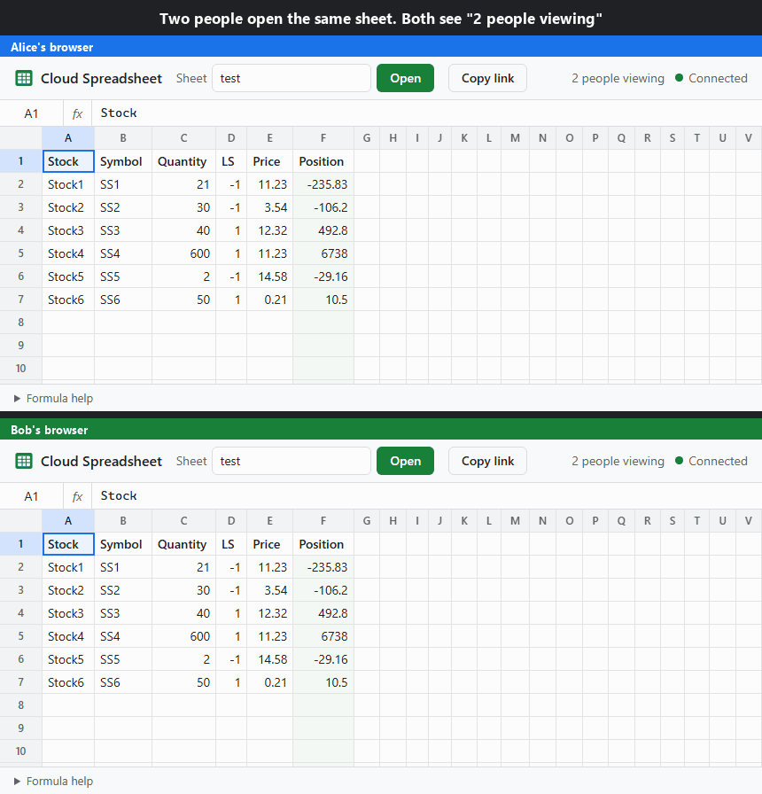
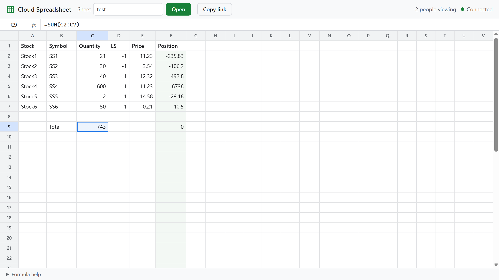

<!--
  Copyright (C) 2026 Bharath K A (bkumarbk9)
  SPDX-License-Identifier: AGPL-3.0-only
-->

# Cloud Spreadsheet

A real-time, collaborative spreadsheet in the browser, like a small Google Sheets. Everyone who opens the same sheet sees each other's edits instantly, formulas recalculate on the server, and changes save automatically.



## Contents
- [Features](#features)
- [Formulas](#formulas)
- [Run it locally](#run-it-locally)
- [Configuration](#configuration)
- [How it works](#how-it-works)
- [Deploying to Azure Container Apps](#deploying-to-azure-container-apps)
- [Project structure](#project-structure)
- [History](#history)
- [License](#license)

## Features
- **Live collaboration.** Edits are pushed over WebSockets to everyone viewing the sheet, along with how many people are viewing it.
- **Formulas.** Google Sheets-style cell formulas (`=B2*C2`, `=SUM(D2:D20)`) and the original whole-column formulas (`Total=Quantity*Price`).
- **Autosave.** Changes are saved every 2 seconds and when the server shuts down. There's no Save button.
- **Share by link.** The sheet name is part of the URL (`?sheet=budget`); **Copy link** copies it.
- **Spreadsheet keyboard.** Arrow keys, Enter, Tab, F2, Delete and type-to-edit, plus a formula bar showing what's in the selected cell.
- **Idle disconnect.** After 30 minutes without use the page disconnects, so a forgotten tab doesn't keep the server running. **Reconnect** picks up where you left off, including an edit you had started.
- **Recovers from dropped connections.** The page reconnects by itself with backoff when the network drops.
- **Light and dark themes**, following your system setting.

## Formulas


| | Example | Notes |
|---|---|---|
| Cell formula | `=B2*C2`, `=SUM(C2:C7)` | Starts with `=`. References like `B2`, `$B$2` and ranges like `A1:C5`. |
| Column formula | `Position=Quantity*LS*Price` | Typed in a header cell (row 1). Calculates every row below from the columns it names. A row stays blank until one of those columns has a value. Its cells can't be edited by hand. |
| Column titles in cell formulas | `=Quantity*Price` | Means "these columns, in this row". |

- **Operators:** `+ - * / ^ %`, `&` (join text), `= <> < > <= >=`. As in Excel, `-2^2` is 4.
- **Functions:**
  - Totals: `SUM AVERAGE MIN MAX COUNT`
  - Maths: `ROUND ABS SQRT POWER MOD INT LOG LN EXP`
  - Logic: `IF`
  - Trigonometry: `SIN COS TAN` and their inverse and hyperbolic forms
  - Other: `PI`, and the muParser names the 2015 version used (`AVG`, `LOG10`, `RINT`, `SIGN`)
- **Errors** appear in the cell: `#DIV/0!`, `#VALUE!`, `#REF!`, `#NAME?`, `#NUM!`, `#ERROR!` (syntax), and `#CYCLE!` for a formula that depends on itself.
- **Numbers** always use `.` as the decimal point, whatever language the server or browser uses.

## Run it locally
You need the [.NET 10 SDK](https://dotnet.microsoft.com/download).

```bash
git clone https://github.com/bkumarbk9/gitRepo.git
cd gitRepo/Projects/CloudSpreadsheet/src
dotnet run --project CloudSpreadsheet
```

Open http://localhost:5080. The **test** sheet opens first; it's the sample from the original article. Open the same URL in a second window to see edits appear live.

Run the tests:

```bash
dotnet test CloudSpreadsheet.slnx
```

The 63 tests cover:
- the formula engine;
- loading the 2015 sample;
- protection against unsafe sheet names;
- two-browser collaboration, autosave and idle disconnect, against the real app running in memory.

## Configuration
Settings live in the `Spreadsheet` section of `appsettings.json`. You can also set them with environment variables, such as `Spreadsheet__DataDirectory=/mnt/sheets`.

| Setting | Default | Meaning |
|---|---|---|
| `DataDirectory` | *(empty)* | Folder for saved sheets. Empty means a `CloudSpreadsheet` folder in the user's local app data. |
| `SampleDirectory` | `SampleSheets` | Read-only sample sheets, opened when no saved sheet has that name. |
| `SaveInterval` | `00:00:02` | How often changed sheets are saved. |
| `IdleTimeout` | `00:30:00` | Disconnect a browser that has been idle this long. |
| `MaxConnections` | `500` | Connections across all sheets. |
| `MaxUsersPerSheet` | `50` | People on one sheet at once. |
| `MaxMessagesPerSecond` | `30` | Edits one browser may send per second. |
| `AllowedOrigins` | `[]` | Other web sites allowed to connect. The app's own site is always allowed. |

## How it works
```
Browser (wwwroot/app.js)  ──WebSocket /ws?sheet=name──►  SheetSocketEndpoint
        ▲                                                       │ edit
        │ snapshot / changed cells / presence                   ▼
        └───────────────────────────────────────────  SheetSession (one per open sheet)
                                                          │  SheetCalculator recalculates
                                                          ▼
                                    SheetHub ── SheetSaveService ──► FileSheetStore (JSON files)
```

1. The browser opens a WebSocket for one sheet and receives a **snapshot**: every cell's text and computed value.
2. An edit is sent as `{ "type": "edit", "cell": "B2", "value": "=A2*2" }`. The server applies edits one at a time, recalculates the sheet, and sends only the **changed cells** to everyone on the sheet. Every browser sees the same edits in the same order.
3. While someone is using the page it sends `{ "type": "active" }` at most once a minute. If nothing arrives for `IdleTimeout`, the server closes the connection with code 4000, and the page shows **Reconnect**.
4. Every few seconds `SheetSaveService` writes changed sheets to disk, and it saves once more on shutdown.

**Security.** Sheet names become file names, so only `A-Z a-z 0-9 - _` are accepted, and paths are checked to stay inside the data folder. The WebSocket accepts only the app's own web site, and messages, edit rate and connections are limited. Pages are served with a strict Content Security Policy.

## Deploying to Azure Container Apps
Container Apps suits this app:
- it supports WebSockets;
- it can scale to zero, so it costs nothing while nobody is using it;
- the idle disconnect means forgotten tabs don't keep it running.

The image is built by the .NET SDK, with no Dockerfile needed:

```bash
dotnet publish CloudSpreadsheet/CloudSpreadsheet.csproj -c Release -r linux-x64 -t:PublishContainer \
  -p:ContainerRegistry=ghcr.io -p:ContainerRepository=<owner>/cloudspreadsheet
```

When you create the Container App:
- **Ingress:** external, target port **8080**.
- **Replicas:** min 0, **max 1**. Open sheets live in the server's memory, so there must be exactly one copy of the server.
- **Storage:** the container's disk is wiped when it scales to zero. To keep saved sheets, mount an Azure Files share and set `Spreadsheet__DataDirectory` to its mount path. Without it, saved sheets are lost on restart (the `test` sample always comes back).
- **Health probe:** `GET /healthz`.

The first visitor after an idle period waits a few seconds while the app starts.

## Project structure
```
CloudSpreadsheet/
├── src/
│   ├── CloudSpreadsheet.slnx
│   ├── CloudSpreadsheet/              ASP.NET Core app (namespace BK_CloudSpreadsheet)
│   │   ├── Formulas/                  Formula parser, functions and sheet calculator
│   │   ├── Sheets/                    Sheet model, cell addresses, names, storage, 2015 file reader
│   │   ├── Realtime/                  WebSocket endpoint, sessions, hub, autosave
│   │   ├── SampleSheets/test.csv      The sample sheet from the original article
│   │   └── wwwroot/                   Browser client (HTML, CSS, JavaScript; no build step)
│   └── CloudSpreadsheet.Tests/        MSTest unit and integration tests
├── doc/                               Article text and figures; img/ holds the demo GIF and screenshot
├── article/Article.pdf                The original CodeProject article
└── REUSE.toml                         License of files that can't hold a header (images, PDF, CSV)
```

## History
- **2015:** first published on CodeProject as *An Online Spreadsheet in C# .NET (Cloud SaaS)*. It had a hand-written WebSocket server on .NET Framework 4.5 and the muParser formula library. That code is kept unchanged, as the article describes it, in [`LegacyProjects/prototypeProjects/CloudSpreadsheet`](../../LegacyProjects/prototypeProjects/CloudSpreadsheet). The article is preserved in [`article/Article.pdf`](article/Article.pdf), thanks to the Wayback Machine.
- **2026:** rewritten on .NET 10 and ASP.NET Core:
  - live collaboration and autosave;
  - cell formulas, with a built-in formula engine instead of the native muParser DLL;
  - security fixes: the old server could read or write any file on the machine through the sheet name;
  - tests, and deployment to Azure Container Apps.

## License
Copyright (C) 2026 Bharath K A (bkumarbk9)

Licensed under the GNU Affero General Public License v3.0 only (`AGPL-3.0-only`). See [LICENSE](LICENSE) for the full text. Every source file carries this notice; [REUSE.toml](REUSE.toml) covers files that can't.
