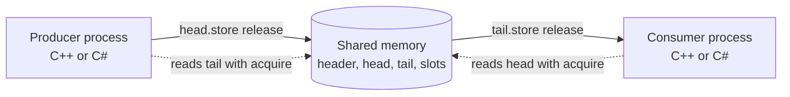

# SPSC Ring Buffer (Shared Memory)

**A lock-free, single-producer / single-consumer ring buffer in POSIX shared memory, with no locked instructions on the hot path.**

A header-only **C++20** ring buffer that two processes share through `shm_open` and `mmap`. It uses cache-line isolated indices, shadow-cached remote indices, and acquire/release ordering, so each push or pop touches only lines its own side owns. A **C#/.NET 10** client uses the same segment layout, so a C++ publisher and a C# subscriber (or the reverse) can exchange messages.

> [!NOTE]
> The benefits of cache-line isolation and shadow indices have **not been benchmarked** yet. The codegen check confirms the hot path emits no locked or fenced instructions. Latency numbers are not published for this project.


---

## Table of contents
- [SPSC Ring Buffer (Shared Memory)](#spsc-ring-buffer-shared-memory)
  - [Table of contents](#table-of-contents)
  - [Features](#features)
  - [Technologies used](#technologies-used)
  - [Architecture](#architecture)
    - [Layout](#layout)
    - [Ordering](#ordering)
    - [Contract](#contract)
    - [Design notes](#design-notes)
  - [Getting started](#getting-started)
    - [Prerequisites](#prerequisites)
    - [Build and test (Linux)](#build-and-test-linux)
    - [Codegen check](#codegen-check)
  - [Samples (publish / subscribe)](#samples-publish--subscribe)
  - [Verification](#verification)
  - [Project structure](#project-structure)
  - [Roadmap](#roadmap)
  - [License](#license)

---

## Features

- **Lock-free, one producer and one consumer.** Each side has its own index in shared memory and never waits for a lock.
- **Acquire/release ordering only.** The publish and free operations use `release` stores, and the matching reads use `acquire` loads. No `seq_cst`, fences, or read-modify-write operations on the hot path.
- **Cache-line isolation.** Each index and the slot array start on a 128-byte boundary, to avoid false sharing with the adjacent-line prefetcher.
- **Shadow indices.** Each side keeps a cached copy of the other side's index, and reads the shared atomic only when the cache says the ring is full or empty.
- **Zero-copy tests and samples.** Single-thread, zero-copy, threaded stress and cross-process tests are included.
- **Cross-language.** A C++ publisher and a C# subscriber share the same segment layout, and the reverse works too.
- **Checked attach.** `attach()` verifies that both sides use the same element type and capacity.

## Technologies used

| Area | Technology |
|---|---|
| Core library | **C++20**, header-only templates, `static_assert` and type traits |
| Shared memory | **POSIX shared memory** (`shm_open`, `mmap`), with the segment header carrying magic, version and element shape |
| Memory model | `std::atomic` with `acquire`/`release` ordering |
| C# client | **C# 14 on .NET 10**, `libc.so.6` P/Invoke for `shm_open` and `mmap` |
| Build | **g++** with `-std=c++20`, `-Wall -Wextra -Wpedantic`; `-lrt` on glibc older than 2.34 |
| Verification | **ThreadSanitizer** on the threaded test, **`objdump`** codegen probe, GoogleTest-free test executables |
| Tested with | **GCC 14.4** (`gcc:14` container) on Linux x86_64 |
| Platform | **Linux x86_64 only** |

## Architecture

The ring is one shared-memory segment. The producer and consumer each map it, and each side keeps its own index and a cached copy of the other side's.



### Layout

| Offset | Size | Contents |
|---|---|---|
| 0 | 128 | Header: magic, version, element shape, `ready` flag |
| 128 | 128 | `head` (producer-written) |
| 256 | 128 | `tail` (consumer-written) |
| 384 | N × stride | slots, each `alignas(64)` |

The 128-byte isolation unit covers the adjacent-line prefetcher. Local shadow indices and cached remote indices stay in each handle, not in shared memory.

### Ordering

- Producer: `head.store(release)`. Consumer: `head.load(acquire)`.
- Consumer: `tail.store(release)`. Producer: `tail.load(acquire)`.
- No seq_cst, fences, or lock-prefixed instructions on the hot path.

### Contract

- One producer and one consumer handle, each used by a single thread. Not enforced across processes.
- `T` must be trivially copyable and standard-layout, with no pointers or vtables.
- `Capacity` is a power of two, known at compile time. Both sides must use the same `T` and `Capacity`; `attach()` checks this.

### Design notes

**Cache-line isolation (`kIsolation = 128`).** Each index and the slot array start on a 128-byte boundary. Intel's adjacent-line (spatial) prefetcher can fetch the buddy line of a 64-byte pair, so with 64-byte alignment alone, the producer's and consumer's indices could still share a fetched pair. The layout offsets are checked at compile time (`offsetof(L, head) == 128`, and so on). This is a layout choice. Whether it helps on a given CPU has not been measured here, and AMD and ARM parts behave differently.

**Shadow indices (`cached_tail_` / `cached_head_`).** Each side keeps its own index in a private variable and a cached copy of the other side's index. The shared atomic is read only when the cache says the ring is full (producer) or empty (consumer). In the common case, a push or pop touches only lines its own side owns. This reduces cross-core cache-line transfers. The benefit has not been benchmarked.

**Memory ordering on x86_64.** The publish and free operations use `release` stores, and the matching reads use `acquire` loads. On x86-64's TSO model, these compile to plain `mov` instructions. No `lock`-prefixed instructions or `mfence` are emitted, which the codegen probe confirms for the hot functions. Read-modify-write operations and `seq_cst` are not used.

**Trivially copyable payloads.** `T` is copied byte-for-byte into shared memory, so it must be trivially copyable and standard-layout, with no pointers or vtables. These rules are enforced with `static_assert` and type traits, not C++20 concepts.

## Getting started

### Prerequisites
- Linux on x86_64
- g++ with C++20 support (verified with GCC 14.4)
- [.NET 10 SDK](https://dotnet.microsoft.com/download) for the C# sample

### Build and test (Linux)

```sh
g++ -std=c++20 -O2 -Wall -Wextra -Wpedantic -Isrc tests/test_spsc.cpp -o test_spsc -pthread
./test_spsc 5000000

# Data-race check of the threaded test (in-process mapping):
g++ -std=c++20 -O1 -g -fsanitize=thread -Isrc tests/test_spsc.cpp -o test_spsc_tsan -pthread
./test_spsc_tsan 200000
```

Older glibc (< 2.34) may also need `-lrt`.

### Codegen check

Confirms there are no locked or fenced instructions on the hot path:

```sh
g++ -std=c++20 -O2 -Isrc -c tests/codegen.cpp -o codegen.o
objdump -d --no-show-raw-insn codegen.o | grep -E 'lock|mfence|xchg|cmpxchg|xadd'   # expect no output
```

## Samples (publish / subscribe)

Two clients with the same wire layout. Either one can publish and the other can subscribe.

- `samples/cpp/shm_demo.cpp`: C++ client.
- `samples/csharp/ShmDemo/`: C# client, .NET 10. Uses `libc.so.6` P/Invoke for `shm_open` and `mmap`.

Start the publisher first; the subscriber attaches to a segment that already exists. Type lines into the publisher; `quit` or EOF stops it.

```sh
# C++ publisher, C# subscriber
g++ -std=c++20 -O2 -Wall -Wextra -Wpedantic -Isrc samples/cpp/shm_demo.cpp -o shm_demo -pthread
./shm_demo pub /demo          # terminal 1: type lines
dotnet run --project samples/csharp/ShmDemo -- sub /demo    # terminal 2

# C# publisher, C++ subscriber
dotnet run --project samples/csharp/ShmDemo -- pub /demo    # terminal 1: type lines
./shm_demo sub /demo          # terminal 2
```

Notes:
- The message is a 64-byte struct, `{ u64 seq; i64 ts_ns; char text[48]; }`. Both sides use the same ring capacity (1024).
- Stopping the publisher with Ctrl+C skips cleanup and leaves `/dev/shm/demo` behind. Remove it with `rm /dev/shm/demo`. Normal exit (`quit`/EOF) cleans up.
- The C# client targets glibc 2.34+ (`shm_open` in `libc.so.6`).

## Verification

Verified with GCC 14.4 (`gcc:14` container):
- The build is clean under `-Wall -Wextra -Wpedantic`, and the tests pass.
- ThreadSanitizer reports no data races on the threaded test.
- The codegen probe finds no locked or fenced instructions.

**Not yet verified:** Clang, and the hugepage and `mlock` paths, which are not implemented.

## Project structure

```
SPSC_HFT_RingBuffer/
├── LICENSE                           # GNU AGPL-3.0
├── README.md
├── src/
│   └── spsc_shm_ring.hpp             # The header-only ring buffer
├── tests/
│   ├── test_spsc.cpp                 # Single-thread, zero-copy, threaded and cross-process tests
│   └── codegen.cpp                   # Codegen probe for the hot path
└── samples/
    ├── cpp/shm_demo.cpp              # C++ publish/subscribe client
    └── csharp/ShmDemo/               # C# publish/subscribe client (.NET 10)
```

## Roadmap

- [x] Header-only ring with cache-line isolation and shadow indices
- [x] Tests, ThreadSanitizer run and codegen check on GCC 14.4
- [x] C++ and C# clients that share the segment layout
- [ ] Verify with Clang
- [ ] Hugepage and `mlock` support
- [ ] Benchmark cache-line isolation and shadow indices on Intel, AMD and ARM

## License

This project is licensed under the **GNU Affero General Public License v3.0 only** (`AGPL-3.0-only`). See [LICENSE](LICENSE) for the full text. Each source file carries the same copyright and SPDX header.

In short: you may use, study, modify and share this software. If you distribute it, **or let users interact with a modified version over a network**, you must make your modified source code available to those users under the same license.

This program comes with **absolutely no warranty**.

### Commercial licensing

Want to use this code in a closed-source product or service, without the AGPL obligation to publish your source code? A **commercial license** is available. Contact **bkumarbk@gmail.com**.
