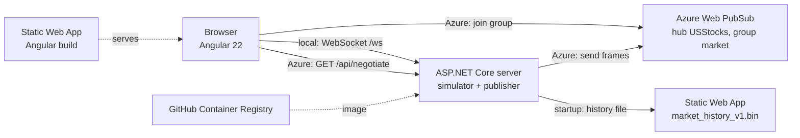

# Stock Ticker with Risk, Microstructure and Technical Analytics

**Live stock prices in the browser for about 7,000 NASDAQ common stocks, with risk, microstructure and technical analytics for each one.**

A real-time dashboard built with **ASP.NET Core on .NET 10** and **Angular 22**. A server simulates prices for every stock in the NASDAQ symbol directories, anchored to 504 days of real daily closes, and streams them to the browser as binary **Protobuf** frames. It runs locally in one step, and in Azure with **Azure Web PubSub**, **Azure Container Apps** and **Azure Static Web Apps**.

> [!NOTE]
> **Prices are simulated.** Only the daily closes come from real history. Intraday moves are generated, so the numbers are for demonstration, not trading.


**Try the live demo**:
<a href="https://ambitious-moss-00a67b20f.4.azurestaticapps.net/"
   target="_blank"
   style="display:inline-block;padding:10px 16px;background:#0078D4;color:white;border-radius:6px;text-decoration:none;font-weight:600;">
   ▶ Try Live Demo
</a>

The page loads in the browser. Prices come from the Azure server, so allow a few seconds after the page opens. Each browser session lasts 10 minutes. After that, refresh the page to start a new one.

---

## Table of contents
- [Stock Ticker with Risk, Microstructure and Technical Analytics](#stock-ticker-with-risk-microstructure-and-technical-analytics)
  - [Table of contents](#table-of-contents)
  - [Sample results](#sample-results)
  - [Features](#features)
  - [Technologies used](#technologies-used)
  - [Architecture](#architecture)
  - [Simulated market](#simulated-market)
  - [Fields](#fields)
  - [Wire format](#wire-format)
  - [API](#api)
  - [Math audit](#math-audit)
  - [Getting started](#getting-started)
    - [Prerequisites](#prerequisites)
    - [Configuration](#configuration)
    - [Run locally](#run-locally)
  - [Deploy to Azure](#deploy-to-azure)
  - [Project structure](#project-structure)
  - [Tests](#tests)
  - [Roadmap](#roadmap)
  - [License](#license)
    - [Commercial licensing](#commercial-licensing)

---

## Sample results

**Popular tab, live prices:**


**Watch tab, with the picked stocks filling in:**


**Math audit, showing how the Watch values are calculated:**


---

## Features

- **Full NASDAQ universe.** About 7,000 common stocks, from the NASDAQ Trader symbol directories. ETFs and test issues are dropped.
- **Simulated prices anchored to real history.** Each simulated day ends on that day's real close from a 504-day file.
- **Live Watch and Popular tables.** Pick stocks on the Universe tab to watch them. Popular shows the most-watched list.
- **Risk, microstructure and technical measures.** Volatility, VaR, beta, Sharpe, drawdown, buy pressure, slippage, VWAP, RSI, ATR and 52-week range.
- **Math audit.** Click any calculated value to see its formula, the numbers plugged in, and a CSV you can check in Excel.
- **Efficient updates.** Binary Protobuf frames with delta values. Only changed fields are sent.
- **Two deployment modes, one code base.** Local runs use a plain websocket. Azure uses Web PubSub. A config file selects the mode.
- **Mobile and desktop layouts.** Every view has both.

## Technologies used

| Area | Technology |
|---|---|
| Language and runtime | **C# 14**, **.NET 10** |
| Server | **ASP.NET Core** (minimal APIs, WebSockets, `IHostedService` background workers) |
| Wire format | **Protocol Buffers** (`Google.Protobuf` on the server, `protobufjs` in the browser) |
| Web client | **Angular 22** (standalone components, signals, built-in `@if` / `@for` control flow), **TypeScript 6** |
| Real-time transport (local) | Plain **WebSocket** from the server to the browser |
| Real-time transport (Azure) | **Azure Web PubSub** (`Azure.Messaging.WebPubSub` on the server, `@azure/web-pubsub-client` in the browser) |
| Server hosting | **Azure Container Apps**: one replica, HTTPS ingress, container secret for the Web PubSub connection string |
| Container build | **.NET SDK container publish** (`dotnet publish -t:PublishContainer`), no Dockerfile |
| Container registry | **GitHub Container Registry** (`ghcr.io`) |
| Frontend and data hosting | **Azure Static Web Apps** (Free plan), one site for the Angular app and one for the history file |
| CI/CD | **GitHub Actions** |
| Historical data | Daily closes from the [Cholesky Market Stream](../cholesky-market-stream) project |

## Architecture



**Local.** The server runs the simulator and sends one frame to each browser every 500 ms over its websocket. The Angular dev server proxies `/api`, `/proto` and `/ws` to the server.

**Azure.** The browser calls `/api/negotiate`, which opens a session and returns a client URL that can only join the `market` group. The server publishes one frame every 500 ms to that group. Each browser sends its picks to `/api/picks` with its session ID. Each session ends after `Feed:SessionMinutes`.

**Request flow (Azure)**
1. The server reads the history file from the Static Web App at startup, and keeps a copy in `/tmp`.
2. The simulator steps every 500 ms, and the server works out which stocks anyone has picked.
3. The publisher sends the changed values, plus a keyframe with every value every 5 seconds, so a browser that joins late can catch up.
4. The browser applies keyframes and deltas to its table.

## Simulated market

Prices are simulated, but each simulated day is anchored to a real daily close from the price history file
(`data/market_history_v1.bin`, written by the cholesky-market-stream project).

- **Each day ends on the file's close.** Within the 390-minute session, the minute path is a bridge from the previous
  day's close to the day's close. The last minute's bar closes exactly on the file's close.
- **Volatility and beta come from the file.** Each stock's annualized volatility and its beta to the average of all
  stocks are measured from the file's daily log returns. So the reported volatility, VaR and regime agree with the file.
- **Tier comes from the price level**, because the file has no market capitalisation: under $5 Penny, under $25 Small,
  under $150 Mid, and the rest Large. Pinned large caps (AAPL, MSFT, NVDA and others) stay Large. The file has no
  stocks below $1, so the Penny tier is the lowest-priced stocks, not sub-dollar stocks.
- **52-week high and low** come from the 252 closes before the day. Today's close is not used until it has happened.
- **Daily limit.** Prices stay within the tier's daily limit of the previous close, widened when needed so the day's
  close is always inside the band.
- **Days cycle.** The server starts at history day 252 (`HISTORY_START_DAY`), runs to the last day, then wraps to
  day 252. The wrap is one large move, since the file's last close and first close are not consecutive.
- **Tickers missing from the file** are not priced, and the server removes them from the universe at startup. The
  startup log says how many were removed.
- The minute path inside a day is simulated. Only the daily closes are real, so intraday highs, lows and volume are
  not the market's.

The random-walk model (no file) is still in the code, for the unit tests.

## Fields

Each stock shows these fields. Measures that need history appear after a warm-up (for example RSI needs 15 minutes).

- **Quote:** bid, ask, last, sizes, open, high, low, previous close, volume, tier.
- **Risk:** realized volatility (annualized, from one-minute returns), 1-day 95% VaR, beta to the index, Sharpe (one session), maximum drawdown in the session, and a regime badge (Low, Elevated, High risk).
- **Microstructure:** buy pressure (bid share of top-of-book size), relative volume, slippage for a $100,000 buy (against the simulated ask ladder), VWAP and distance from VWAP.
- **Technicals:** RSI(14), ATR(14), 52-week high and low, and where the price sits in that range.

## Wire format

The server sends each browser one binary **protobuf** frame every 500 ms, defined in `src/backend/StockTickerNasdaq.Market/Protos/market.proto`. The browser loads the same schema from `/proto/market.proto`.

- **Ids, not symbols.** Each pick gets a new ticker id for that connection. The frame that first announces the pick carries the symbol.
- **Columns, not rows.** One column per field, holding the ticker id and the change for each stock that changed.
- **Deltas, in fixed-point integers.** Prices carry four decimal places; sizes and counts carry none. Each delta is the change since the value that browser last received, so a one-cent move is a small number.
- **Changed values only.** A field is sent only when it changes.
- **Keyframes (Azure).** A message that starts with byte `1` is a keyframe with every current value. Browsers reset to it, so a late joiner catches up. A byte `0` marks a normal delta.

About 3 bytes per update in steady state, against about 19 for the earlier JSON messages. Measured with 100 picks, where sizes and volume change on almost every tick.

## API

| Method and path | Purpose |
|---|---|
| `GET /api/universe?q=&page=&pageSize=&set=` | Search the universe. `set=popular` returns the Popular list. |
| `GET /api/status` | Session, minute, number of priced stocks and streamed stocks. |
| `GET /proto/market.proto` | The wire schema for the browser. |
| `GET /ws` | Local only: the websocket that carries the frames. |
| `GET /api/negotiate` | Azure only: opens a session and returns the Web PubSub client URL and session ID. |
| `POST /api/picks` | Azure only: the browser's picks for its session (`X-Session-Id` header). |
| `GET /api/audit/{ticker}` | The math audit as JSON. |
| `GET /api/audit/{ticker}/intraday.csv` | The live session bars as CSV. |
| `GET /api/audit/{ticker}/504d.csv` | The 504-day closes and returns as CSV. |

## Math audit

Click any row on the Watch tab to open the math audit drawer. It shows how each Risk, Microstructure and Technical value
was derived, with the numbers plugged in, in two labelled sections:

1. **Live intraday session.** Recomputed from the same closed one-minute bars and order-book state as the table. Download
   the bars as `<TICKER>_intraday_audit.csv`.
2. **504-day historical baseline.** From the history file: volatility, VaR (parametric and historical), beta against the
   universe, Sharpe with a 4% risk-free rate, maximum drawdown with dates, the 52-week range, a 30-bin return histogram,
   and the 2-year price chart. Download the closes as `<TICKER>_504d_audit.csv`. The drawer lists Excel formulas that
   reproduce the numbers from that CSV (`AVERAGE`, `STDEV.S`, `PERCENTILE.INC`, `SLOPE`).

The backend computes every number, formula and chart position. The browser only displays them.

Notes:
- The intraday Sharpe has no risk-free rate, to match the table. The 504-day Sharpe does use 4%.
- Intraday VaR uses the same 1.645 quantile as the table. Historical VaR uses the interpolated 5% quantile
  (PERCENTILE.INC).
- The universe mean beta is 1.00 by construction, because the universe is the average of the same stocks.
- Dates are weekdays from 2024-01-01. The file has no holidays.

---

## Getting started

### Prerequisites
- [.NET 10 SDK](https://dotnet.microsoft.com/download)
- [Node.js](https://nodejs.org/) 22.22+ or 24 (the Angular client)
- The history file `data/market_history_v1.bin` (about 14 MB), already in this repository's `data` folder
- For Azure: an Azure subscription, a Web PubSub resource, a Container App, and two Static Web Apps (see [Deploy to Azure](#deploy-to-azure))

### Configuration

Configuration lives in files. The only value kept out of files is the Web PubSub connection string, which is a secret.

`src/backend/StockTickerNasdaq.Server/appsettings.json` chooses the profile:

```json
"Deployment": { "Profile": "azure" }
```

The server then layers `appsettings.{Profile}.json` on top. Locally, `appsettings.Development.json` sets the profile to `local`. The `launchSettings.json` runs the server in the Development environment, so `dotnet run` uses the local profile.

| Setting | Where | Local | Azure | Meaning |
|---|---|---|---|---|
| `Server:Urls` | profile file | `http://127.0.0.1:5090` | `http://0.0.0.0:8080` | Address the server listens on. |
| `Server:AllowedOrigins` | profile file | empty | the Static Web App address | Browser origins allowed to call the API. |
| `Server:UniverseCacheDirectory` | profile file | default folder | `/tmp/universe-cache` | Where the symbol lists are cached. |
| `Deployment:Transport` | profile file | `local` | `web-pubsub` | How prices reach the browser. |
| `Deployment:HistoryPath` | profile file | `data/market_history_v1.bin` | empty | History file on disk. |
| `Deployment:HistoryUrl` | profile file | empty | the data Static Web App file | History file downloaded at startup. |
| `Deployment:WebPubSubHub` / `WebPubSubGroup` | profile file | | `USStocks` / `market` | Web PubSub hub and group. |
| `Deployment:WebPubSubTokenMinutes` | profile file | | `10` | Lifetime of each browser's client URL. |
| `Deployment:PublishIntervalMs` | profile file | `500` | `500` | Time between published frames. |
| `Deployment:WebPubSubConnectionString` | environment only | | secret | Set as `Deployment__WebPubSubConnectionString`. Never in a file. |
| `Feed:SessionMinutes` | `appsettings.json` | `10` | `10` | Length of each browser session. |
| `Feed:RunForHours` | `appsettings.json` | `2` | `2` | After this long, every browser is told the day has ended. |
| `Feed:EndOfDay` | `appsettings.json` | `23:59` | `23:59` | Local server time when the day ends. |
| `Feed:PauseWhenHidden` | profile file | `true` | `false` | Whether the feed pauses when the browser tab is hidden. |

Other settings are environment variables:

| Variable | Default | Meaning |
|---|---|---|
| `SIM_REAL_SECONDS_PER_MINUTE` | `5` | Real seconds per simulated minute. `5` gives a 390-minute session in about 33 minutes. Use `1` for fast runs. |
| `SIM_SEED` | random | Seed for the simulated prices. Set it to repeat a run. |
| `MAX_PICKS` | `100` | Most stocks one browser can pick. |
| `HISTORY_START_DAY` | `252` | First history day to simulate. It needs 252 earlier closes for the 52-week range. |
| `UNIVERSE_SOURCES` | NASDAQ and other-listed URLs | Comma-separated list of URLs or local files for the symbol directories. |

### Run locally

Terminal 1, the server:

```
cd src/backend/StockTickerNasdaq.Server
dotnet run
```

Terminal 2, the frontend:

```
cd src/frontend
npm install
npm start
```

Open <http://localhost:4200>. Tick stocks on the Universe tab, then open Watch. The status bar shows the simulated session and minute.

## Deploy to Azure

The Azure deployment has four parts. Replace the example names with your own.

1. **Web PubSub.** Create an Azure Web PubSub resource of the **Web PubSub** type (not Socket.IO), on the Free tier. Copy its connection string from **Keys**. The hub name, `USStocks`, is set in `appsettings.azure.json`.
2. **Server image.** The GitHub Actions workflow `.github/workflows/stockticker-nasdaq-ghcr.yml` builds the server with the .NET SDK and pushes it to `ghcr.io/<owner>/stockticker-nasdaq-server`. It runs on each push to `main` that changes the backend. Set the package to **Public** in GitHub, so Container Apps can pull it without credentials.
3. **Container App.** Create a Container App from that image, with **external** ingress on port **8080**, and a minimum and maximum of **1** replica (one simulator). Add a container secret `webpubsub-connection` with the Web PubSub connection string, and an environment variable `Deployment__WebPubSubConnectionString` that references that secret. Each new build needs a **new revision** to be used.
4. **Static Web Apps.** Create two Free-plan Static Web Apps from this repository:
   - **Frontend:** app location `Projects/StockTickerMarketDataNASDAQ/src/frontend`, output location `dist/frontend/browser`. The production build uses `environment.azure.ts`, which holds the Container App address.
   - **Data:** app location `Projects/StockTickerMarketDataNASDAQ/data`, with no output location. It serves `market_history_v1.bin` and needs an `index.html` placeholder at its root.

Put the frontend's address in `Server:AllowedOrigins` and the data file's address in `Deployment:HistoryUrl`, then commit.

## Project structure

```
StockTickerMarketDataNASDAQ/
├── LICENSE                                   # GNU AGPL-3.0
├── README.md
├── data/
│   ├── index.html                            # placeholder for the data Static Web App
│   ├── market_history_v1.bin                 # 504 days of daily closes (about 14 MB)
│   └── nasdaq_symbols.txt
├── docs/                                     # GIFs and screenshots used in this README
├── src/
│   ├── backend/
│   │   ├── StockTickerNasdaq.Universe/       # NASDAQ symbol files: parsing and download
│   │   ├── StockTickerNasdaq.Market/         # Quotes, simulator, history reader, analytics, Protobuf schema
│   │   └── StockTickerNasdaq.Server/         # ASP.NET Core server: API, websocket, Web PubSub publisher
│   │       ├── appsettings.json              # Profile selection and feed settings
│   │       ├── appsettings.Development.json  # Local profile
│   │       ├── appsettings.local.json        # Local settings
│   │       └── appsettings.azure.json        # Azure settings
│   └── frontend/
│       ├── public/staticwebapp.config.json   # Routes unknown addresses to the app
│       └── src/
│           ├── environments/                 # environment.ts (local) and environment.azure.ts (cloud)
│           └── app/                          # Universe, Watch, Popular and the math audit
└── tests/                                    # Universe, Market and analytics unit tests
```

## Tests

```
dotnet test
```

## Roadmap

- [x] Local end-to-end flow with simulated prices and the math audit
- [x] Azure Web PubSub transport, with session limits and keyframes
- [x] Cloud build with its own configuration file
- [ ] Confirm the live Azure demo end to end on a fresh browser profile
- [ ] Send each browser's picks through Web PubSub instead of the REST endpoint
- [ ] Serve the history file from the Container App or a Blob container
- [ ] Unit and integration tests for the Web PubSub publisher
- [ ] Managed identity for the Web PubSub connection

## License

Copyright (C) 2026 Bharath K A (bkumarbk9)

This project is licensed under the **GNU Affero General Public License v3.0 only** (`AGPL-3.0-only`). See [LICENSE](LICENSE) for the full text.

In short: you may use, study, modify and share this software. If you distribute it, **or let users interact with a modified version over a network** (for example, by hosting it as a web service), you must make your modified source code available to those users under the same license.

This program comes with **absolutely no warranty**.

### Commercial licensing

Want to use this code in a closed-source product or service, without the AGPL obligation to publish your source code? A **commercial license** is available. Contact **bkumarbk@gmail.com**.
