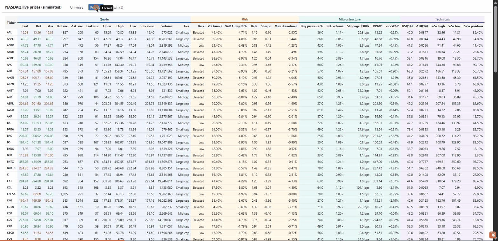
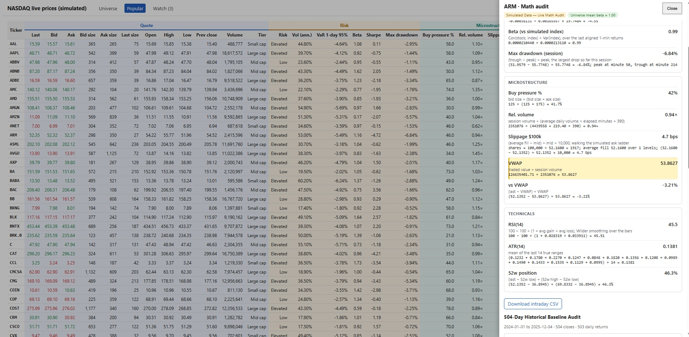
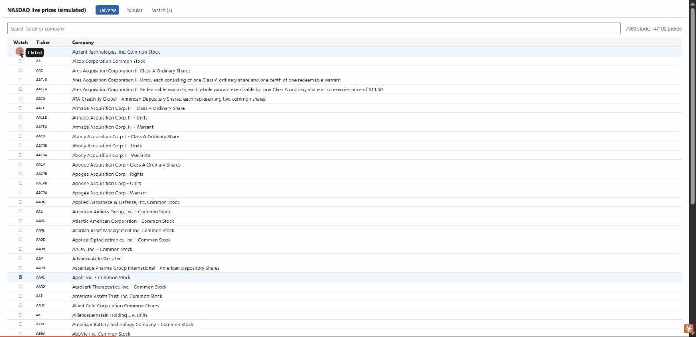

# StockTicker NASDAQ

Live stock prices in the browser, for the NASDAQ common-stock universe. **Prices are simulated** and anchored to the daily closes of a 504-day history file, so the dashboard can show large cap, mid cap, small cap and penny stocks moving with realistic risk and liquidity measures.

**Status:** local end-to-end flow with simulated prices, anchored to the history file. Azure Web PubSub replaces the local websocket later; the message format stays the same.

**Try me:** <a href="https://ambitious-moss-00a67b20f.4.azurestaticapps.net/" target="_blank">https://ambitious-moss-00a67b20f.4.azurestaticapps.net/</a>








## Flow

1. **Universe.** The NASDAQ Trader symbol directories (`nasdaqlisted.txt` and `otherlisted.txt`) give the list of common stocks. ETFs and test issues are dropped. Sources: <https://www.nasdaqtrader.com/trader.aspx?id=symboldirdefs>.
2. **Simulated prices.** Every stock with history is priced in real time by a simulator anchored to the file's daily closes. Browsers pick stocks; the server computes the risk, liquidity and technical measures only for picked stocks.
3. **Publish.** The server sends each browser only the fields that changed, in messages under 2 KB. Azure Web PubSub will fan these out to browsers later.
4. **Browsers.** The first tab lists the whole universe. The second tab shows the picked stocks. Browsers never hold Azure credentials.

## Simulated market

Prices are simulated, but each simulated day is anchored to a real daily close from the price history file
(`data/market_history.bin`, written by the cholesky-market-stream project).

- **Each day ends on the file's close.** Within the 390-minute session, the minute path is a bridge from the previous
  day's close to the day's close. The last minute's bar closes exactly on the file's close.
- **Volatility and beta come from the file.** Each stock's annualized volatility and its beta to the average of all
  stocks are measured from the file's daily log returns. So the reported volatility, VaR and regime agree with the file.
- **Tier comes from the price level**, because the file has no market capitalisation: under $5 Penny, under $25 Small,
  under $150 Mid, and the rest Large. Pinned large caps (AAPL, MSFT, NVDA and others) stay Large. The file has no
  stocks below $1, so the Penny tier is the lowest-priced stocks, not sub-dollar stocks.
- **52-week high and low** come from the 252 closes before the day. Today's close is not used until it has happened.
- **Daily limit.** Prices stay within the tier's daily limit of the previous close, widened when needed so the day's
  close is always inside the band.
- **Days cycle.** The server starts at history day 252 (`HISTORY_START_DAY`), runs to the last day, then wraps to
  day 252. The wrap is one large move, since the file's last close and first close are not consecutive.
- **Tickers missing from the file** are not priced, and the server removes them from the universe at startup. The
  startup log says how many were removed.
- The minute path inside a day is simulated. Only the daily closes are real, so intraday highs, lows and volume are
  not the market's.

The random-walk model (no file) is still in the code, for the unit tests.

## Fields

Each stock shows these fields. Measures that need history appear after a warm-up (for example RSI needs 15 minutes).

- **Quote:** bid, ask, last, sizes, open, high, low, previous close, volume, tier.
- **Risk:** realized volatility (annualized, from one-minute returns), 1-day 95% VaR, beta to the index, Sharpe (one session), maximum drawdown in the session, and a regime badge (Low, Elevated, High risk).
- **Microstructure:** buy pressure (bid share of top-of-book size), relative volume, slippage for a $100,000 buy (against the simulated ask ladder), VWAP and distance from VWAP.
- **Technicals:** RSI(14), ATR(14), 52-week high and low, and where the price sits in that range.

## Wire format

The server sends each browser one binary **protobuf** frame every 500 ms, defined in `src/backend/StockTickerNasdaq.Market/Protos/market.proto`. The browser loads the same schema from `/proto/market.proto`.

- **Ids, not symbols.** Each pick gets a new ticker id for that connection. The frame that first announces the pick carries the symbol.
- **Columns, not rows.** One column per field, holding the ticker id and the change for each stock that changed.
- **Deltas, in fixed-point integers.** Prices carry four decimal places; sizes and counts carry none. Each delta is the change since the value that browser last received, so a one-cent move is a small number.
- **Changed values only.** A field is sent only when it changes.

About 3 bytes per update in steady state, against about 19 for the earlier JSON messages. Measured with 100 picks, where sizes and volume change on almost every tick.

## Layout

- `src/backend/StockTickerNasdaq.Universe`: NASDAQ symbol file parsing and download.
- `src/backend/StockTickerNasdaq.Market`: quote fields, the quote book, the history file reader, the simulator, and the analytics functions.
- `src/backend/StockTickerNasdaq.Server`: local end-to-end server. Serves `/api/universe`, `/api/status` and the `/ws` websocket. It runs the simulator and sends updates every 500 ms.
- `src/frontend`: Angular app with two tabs. Universe picks stocks; Watch shows the picked stocks live. Each view has a mobile layout and a desktop layout.
- `tests/`: unit tests for the universe, the market simulator, the analytics, and the delta sending.

## Local end-to-end test

Terminal 1, the server:

```
dotnet run --project src/backend/StockTickerNasdaq.Server
```

Terminal 2, the front end:

```
cd src/frontend
npx ng serve --port 4200
```

Open <http://localhost:4200>. Tick stocks on the Universe tab, then open Watch. The status bar shows the simulated session and minute.

Server settings (environment variables):

| Variable | Default | Meaning |
|---|---|---|
| `SIM_REAL_SECONDS_PER_MINUTE` | `5` | Real seconds per simulated minute. `5` gives a 390-minute session in about 33 minutes. Use `1` for fast runs. |
| `SIM_SEED` | random | Seed for the simulated prices. Set it to repeat a run. |
| `MAX_PICKS` | `100` | Most stocks one browser can pick. |
| `UNIVERSE_SOURCES` | NASDAQ and other-listed URLs | Comma-separated list of URLs or local files for the symbol directories. |
| `UNIVERSE_CACHE_DIR` | `universe-cache` in the working folder | Where each downloaded symbol file is kept. If a download fails at startup, the cached copy is used, and the console says so. Startup fails only when there is no cached copy either. |
| `HISTORY_FILE` | `data/market_history.bin` | Daily closes from the cholesky-market-stream project. The server does not start without it, and prints the generator command if it is missing. |
| `HISTORY_START_DAY` | `252` | First history day to simulate. It needs 252 earlier closes for the 52-week range. |

## Math audit

Click any row on the Watch tab to open the math audit drawer. It shows how each Risk, Microstructure and Technical value
was derived, with the numbers plugged in, in two labelled sections:

1. **Live intraday session.** Recomputed from the same closed one-minute bars and order-book state as the table. Download
   the bars as `<TICKER>_intraday_audit.csv`.
2. **504-day historical baseline.** From the history file: volatility, VaR (parametric and historical), beta against the
   universe, Sharpe with a 4% risk-free rate, maximum drawdown with dates, the 52-week range, a 30-bin return histogram,
   and the 2-year price chart. Download the closes as `<TICKER>_504d_audit.csv`. The drawer lists Excel formulas that
   reproduce the numbers from that CSV (`AVERAGE`, `STDEV.S`, `PERCENTILE.INC`, `SLOPE`).

The backend computes every number, formula and chart position. The browser only displays them.

Endpoints: `GET /api/audit/{ticker}`, `GET /api/audit/{ticker}/intraday.csv`, `GET /api/audit/{ticker}/504d.csv`.

Notes:
- The intraday Sharpe has no risk-free rate, to match the table. The 504-day Sharpe does use 4%.
- Intraday VaR uses the same 1.645 quantile as the table. Historical VaR uses the interpolated 5% quantile
  (PERCENTILE.INC).
- The universe mean beta is 1.00 by construction, because the universe is the average of the same stocks.
- Dates are weekdays from 2024-01-01. The file has no holidays.

## Tests

```
dotnet test
```
