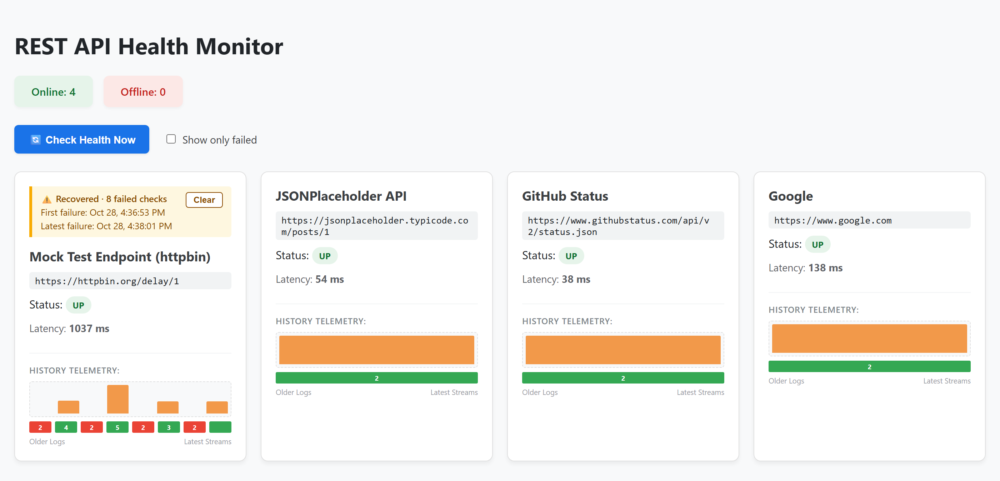

# Projects in BK's repo

Free demo projects that show how to use different technologies, from cloud AI services to desktop apps and real-time web apps. Each project has its own README with full details.

| Project | Area | Tech stack | License |
|---|---|---|---|
| [Azure AI Document Reader](Projects/AzureDocIntelligence) | Cloud AI, REST API | C# 14, .NET 10, ASP.NET Core, Azure AI Document Intelligence, Azure Container Apps, Docker | AGPL-3.0 |
| [REST API Health Monitor](Projects/rest-api-health-monitor) | Web app, monitoring | TypeScript, Angular 22 (signals), Vitest, Azure Static Web Apps, GitHub Actions | AGPL-3.0 |
| [Bonjour in WPF](Projects/BonjourInWPF) | Desktop, networking | C#, WPF, .NET Framework 4.8, MVVM, Zeroconf, Telerik UI for WPF | AGPL-3.0 |
| [Cloud Spreadsheet](LegacyProjects/prototypeProjects/CloudSpreadsheet) *(prototype)* | Real-time web | HTML5, JavaScript, WebSockets, C# server | AGPL-3.0 |

---

## Azure AI Document Reader
📁 [`Projects/AzureDocIntelligence`](Projects/AzureDocIntelligence)

A cloud-native ASP.NET Core Web API that sends PDFs and images to **Azure AI Document Intelligence** (layout model) and returns clean, page-by-page JSON: text paragraphs, page geometry and OCR confidence. It runs as a container on **Azure Container Apps**, with per-IP rate limiting, upload limits, structured logging and a health endpoint built in.

**Try the live demo**:
<a href="https://azdocintelligenceai-app-20261015.whitehill-0f100039.westus2.azurecontainerapps.io/" 
   target="_blank" 
   style="display:inline-block;padding:10px 16px;background:#0078D4;color:white;border-radius:6px;text-decoration:none;font-weight:600;">
   ▶ Try Live Demo
</a>

First time it will take a bit to load the page (warm-up) as it is Azure Container app. This means, it works as desired for zero cost cool down deployment technique.   Next time onwards it will be snappy
**Alternatively..**:
```powershell
curl.exe -s -w "`nHTTP %{http_code}`n" -X POST "https://azdocintelligenceai-app-20261015.whitehill-0f100039.westus2.azurecontainerapps.io/api/docintel/analyze" -F "file=@C:\temp\test.jpg"
```
Add `-o C:\temp\result.json` to save the result to a file instead of printing it.

**Free demo limits:** files up to 2 MB, the first 3 pages are analyzed, and 100 requests per IP address per day. Don't upload confidential documents.

## REST API Health Monitor
📁 [`Projects/rest-api-health-monitor`](Projects/rest-api-health-monitor)

A live, browser-based dashboard built with **Angular 22** that checks websites and REST APIs on a schedule and shows uptime, latency charts, a status timeline and incident tracking for each one. Endpoints are configured in a JSON file, and a built-in test endpoint uses **httpbin.org** to simulate healthy, failing and slow responses. It's deployed to **Azure Static Web Apps** by **GitHub Actions** on every push.

**Try the live demo**:
<a href="https://gray-cliff-0c3ee300f.3.azurestaticapps.net/" 
   target="_blank" 
   style="display:inline-block;padding:10px 16px;background:#0078D4;color:white;border-radius:6px;text-decoration:none;font-weight:600;">
   ▶ Try Live Demo
</a>



## Bonjour in WPF
📁 [`Projects/BonjourInWPF`](Projects/BonjourInWPF)

A Windows desktop tool that uses **mDNS (Bonjour/Zeroconf)** to discover the devices and services on your local network, such as printers, with no configuration. It's built with **WPF** using the MVVM pattern (separate View, ViewModel and Model projects) and **Telerik UI for WPF** controls. Ready-to-run binaries are included in `DemoBinaries`. Building from source requires a Telerik UI for WPF installation.

## Cloud Spreadsheet *(prototype)*
📁 [`LegacyProjects/prototypeProjects/CloudSpreadsheet`](LegacyProjects/prototypeProjects/CloudSpreadsheet)

A lightweight, real-time online spreadsheet that pushes cell updates to all connected browsers over **WebSockets**, demonstrating low-latency synchronization techniques. It includes an HTML/JavaScript client, a C# WebSocket server and a C# spreadsheet service, plus the original CodeProject article (preserved as a PDF).

---

## License

All projects in this repository are licensed under the **GNU Affero General Public License v3.0 only** (`AGPL-3.0-only`). See [LICENSE](LICENSE); each project folder also contains a copy. Third-party libraries included with a project remain under their own licenses.
