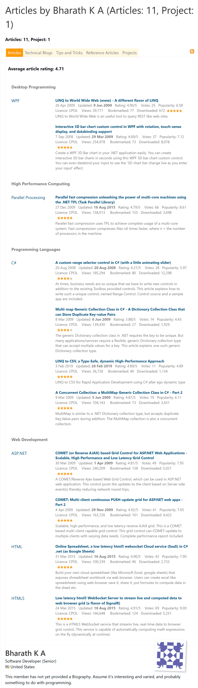

# Projects in BK's repo

Free demo projects that show how to use different technologies, from cloud AI services to desktop apps and real-time web apps. Each project has its own README with full details.

| Project | Area | Tech stack | License |
|---|---|---|---|
| [Azure AI Document Reader](Projects/AzureDocIntelligence) | Cloud AI, REST API | C# 14, .NET 10, ASP.NET Core, Azure AI Document Intelligence, Azure Container Apps, Docker | AGPL-3.0 |
| [REST API Health Monitor](Projects/rest-api-health-monitor) | Web app, monitoring | TypeScript, Angular 22 (signals), Vitest, Azure Static Web Apps, GitHub Actions | AGPL-3.0 |
| [Cloud Spreadsheet](Projects/CloudSpreadsheet) | Real-time web, collaboration | C#, .NET 10, ASP.NET Core WebSockets, JavaScript, MSTest, Azure Container Apps | AGPL-3.0 |
| [Bonjour in WPF](Projects/BonjourInWPF) | Desktop, networking | C#, WPF, .NET Framework 4.8, MVVM, Zeroconf, Telerik UI for WPF | AGPL-3.0 |

**Prototypes**: earlier experiments, kept as originally published and not maintained. Some have grown into the projects above.

| Prototype | Area | Tech stack | Year | License |
|---|---|---|---|---|
| [Cloud Spreadsheet (original)](LegacyProjects/prototypeProjects/CloudSpreadsheet) | Real-time web | HTML5, JavaScript, WebSockets, C# server, .NET Framework 4.5 | 2015 | AGPL-3.0 |

---

## Azure AI Document Reader
📁 [`Projects/AzureDocIntelligence`](Projects/AzureDocIntelligence)

A cloud-native ASP.NET Core Web API that sends PDFs and images to **Azure AI Document Intelligence** (layout model) and returns clean, page-by-page JSON: text paragraphs, page geometry and OCR confidence. It runs as a container on **Azure Container Apps**, with per-IP rate limiting, upload limits, structured logging and a health endpoint built in.

**Try the live demo**:
<a href="https://azdocintelligenceai-app-20261015.whitehill-0f100039.westus2.azurecontainerapps.io/" 
   target="_blank" 
   style="display:inline-block;padding:10px 16px;background:#0078D4;color:white;border-radius:6px;text-decoration:none;font-weight:600;">
   ▶ Try Live Demo
</a>

First time it will take a bit to load the page (warm-up) as it is Azure Container app. This means, it works as desired for zero cost cool down deployment technique.   Next time onwards it will be snappy
**Alternatively..**:
```powershell
curl.exe -s -w "`nHTTP %{http_code}`n" -X POST "https://azdocintelligenceai-app-20261015.whitehill-0f100039.westus2.azurecontainerapps.io/api/docintel/analyze" -F "file=@C:\temp\test.jpg"
```
Add `-o C:\temp\result.json` to save the result to a file instead of printing it.

**Free demo limits:** files up to 2 MB, the first 3 pages are analyzed, and 100 requests per IP address per day. Don't upload confidential documents.

## REST API Health Monitor
📁 [`Projects/rest-api-health-monitor`](Projects/rest-api-health-monitor)

A live, browser-based dashboard built with **Angular 22** that checks websites and REST APIs on a schedule and shows uptime, latency charts, a status timeline and incident tracking for each one. Endpoints are configured in a JSON file, and a built-in test endpoint uses **httpbin.org** to simulate healthy, failing and slow responses. It's deployed to **Azure Static Web Apps** by **GitHub Actions** on every push.

**Try the live demo**:
<a href="https://gray-cliff-0c3ee300f.3.azurestaticapps.net/" 
   target="_blank" 
   style="display:inline-block;padding:10px 16px;background:#0078D4;color:white;border-radius:6px;text-decoration:none;font-weight:600;">
   ▶ Try Live Demo
</a>

## Cloud Spreadsheet
📁 [`Projects/CloudSpreadsheet`](Projects/CloudSpreadsheet)

A real-time, collaborative spreadsheet in the browser, like a small Google Sheets. Everyone on the same sheet sees edits instantly over **WebSockets**. It supports Google Sheets-style formulas (`=SUM(C2:C7)`) and whole-column formulas, saves automatically, and disconnects idle tabs so it can scale to zero on **Azure Container Apps**. Built with **ASP.NET Core on .NET 10**, its own formula engine, and a plain JavaScript client. It is a 2026 rewrite of a 2015 CodeProject article; the original code and article are preserved in [`LegacyProjects/prototypeProjects/CloudSpreadsheet`](LegacyProjects/prototypeProjects/CloudSpreadsheet).

## Bonjour in WPF
📁 [`Projects/BonjourInWPF`](Projects/BonjourInWPF)

A Windows desktop tool that uses **mDNS (Bonjour/Zeroconf)** to discover the devices and services on your local network, such as printers, with no configuration. It's built with **WPF** using the MVVM pattern (separate View, ViewModel and Model projects) and **Telerik UI for WPF** controls. Ready-to-run binaries are included in `DemoBinaries`. Building from source requires a Telerik UI for WPF installation.

---

## Cloud Spreadsheet (original) *(prototype)*
📁 [`LegacyProjects/prototypeProjects/CloudSpreadsheet`](LegacyProjects/prototypeProjects/CloudSpreadsheet)

A lightweight, real-time online spreadsheet that pushes cell updates to the browser over **WebSockets**, demonstrating low-latency messaging. It includes an HTML/JavaScript client, a hand-written C# WebSocket server and a C# spreadsheet service, plus the original CodeProject article (preserved as a PDF). Rewritten as the [Cloud Spreadsheet](Projects/CloudSpreadsheet) project.

---

## My original CodeProject work

Many of these projects began as articles on [CodeProject](https://www.codeproject.com), which is no longer online. This list was captured from the [Wayback Machine copy of my CodeProject article page](https://web.archive.org/web/20240703055712/https://www.codeproject.com/script/Articles/MemberArticles.aspx?amid=2794214) as of **3 Jul 2024**. Article links open the archived copies. Readers rated the articles with **402 votes, averaging 4.71 out of 5**, and viewed them about **1.6 million times**.

| Article | Published | Rating | Votes | Views | Downloads |
|---|---|---|---|---|---|
| [A custom range selector control in C# (with a little animating slider)](https://web.archive.org/web/2024/https://www.codeproject.com/Articles/28717/A-custom-range-selector-control-in-C-with-a-little) | Aug 2008 | 4.27/5 | 28 | 185,294 | 12,298 |
| [Interactive 3D bar chart custom control in WPF with rotation, touch-sense display, and databinding support](https://web.archive.org/web/2024/https://www.codeproject.com/Articles/29151/Interactive-3D-bar-chart-custom-control-in-WPF-wit) | Sep 2008 | 4.69/5 | 37 | 254,978 | 8,078 |
| [Multi-map Generic Collection Class in C# - A Dictionary Collection Class that can Store Duplicate Key-value Pairs](https://web.archive.org/web/2024/https://www.codeproject.com/Articles/33964/Multi-map-Generic-Collection-Class-in-C-A-Dictiona) | Mar 2009 | 3.88/5 | 14 | 139,430 | 1,929 |
| [A Concurrent Collection: a MultiMap Generic Collection Class in C# - Part 2](https://web.archive.org/web/2024/https://www.codeproject.com/Articles/34013/A-Concurrent-Collection-a-MultiMap-Generic-Collect) | Mar 2009 | 4.87/5 | 19 | 104,143 | 3,431 |
| [COMET (or Reverse AJAX) based Grid Control for ASP.NET Web Applications - Scalable, High Performance and Low Latency Grid Control](https://web.archive.org/web/2024/https://www.codeproject.com/Articles/34562/COMET-or-Reverse-AJAX-based-Grid-Control-for-ASP-N) | Mar 2009 | 4.81/5 | 49 | 240,209 | 5,021 |
| [COMET: Multi-client continuous PUSH-update grid for ASP.NET web apps - Part 2](https://web.archive.org/web/2024/https://www.codeproject.com/Articles/34972/COMET-Multi-client-continuous-PUSH-update-grid-for) | Apr 2009 | 4.92/5 | 41 | 163,726 | 4,422 |
| [LINQ to World Wide Web (www) - A different flavor of LINQ](https://web.archive.org/web/2024/https://www.codeproject.com/Articles/35911/LINQ-to-World-Wide-Web-www-A-different-flavor-of-L) | Apr 2009 | 4.90/5 | 25 | 39,771 | 672 |
| [Parallel fast compression unleashing the power of multi-core machines using the .NET TPL (Task Parallel Library)](https://web.archive.org/web/2024/https://www.codeproject.com/Articles/49264/Parallel-fast-compression-unleashing-the-power-of) | Dec 2009 | 4.79/5 | 66 | 158,013 | 3,698 |
| [Low latency html5 WebSocket Server to stream live and computed data to web browser grid (a flavor of SignalR)](https://web.archive.org/web/2024/https://www.codeproject.com/Articles/890092/Low-latency-html-WebSocket-Server-to-stream-live-a) | Mar 2015 | 4.91/5 | 69 | 166,648 | 5,251 |
| [Online Spreadsheet, a low latency html5 websocket Cloud service (SaaS) in C# .net (as Google Sheets)](https://web.archive.org/web/2024/https://www.codeproject.com/Articles/892137/Online-Spreadsheet-a-low-latency-html-websocket-Cl) | Mar 2015 | 4.90/5 | 43 | 100,339 | 2,733 |
| [LINQ to CSV, a Type-Safe, dynamic High-Performance Approach](https://web.archive.org/web/2024/https://www.codeproject.com/Articles/1276238/LINQ-to-CSV-a-Type-Safe-dynamic-High-Performance-A) | Feb 2019 | 4.89/5 | 11 | 36,726 | 1,134 |
| **11 articles** | 2008–2019 | **4.71** average | **402** | **1,589,277** | **48,667** |

There was also one project, [WPF (MVVM pattern) based mDNS (Bonjour) discovery tool](https://web.archive.org/web/2024/https://www.codeproject.com/Articles/5381880/WPF-MVVM-pattern-based-mDNS-Bonjour-discovery-tool), now [Bonjour in WPF](Projects/BonjourInWPF). The Online Spreadsheet article became [Cloud Spreadsheet](Projects/CloudSpreadsheet).

<details open>
<summary>Snapshot of the CodeProject articles page (3 Jul 2024)</summary>


</details>

---

## License

All projects in this repository are licensed under the **GNU Affero General Public License v3.0 only** (`AGPL-3.0-only`). See [LICENSE](LICENSE); each project folder also contains a copy. Third-party libraries included with a project remain under their own licenses.
